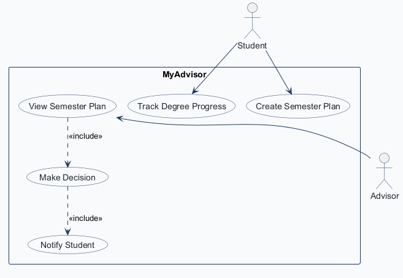
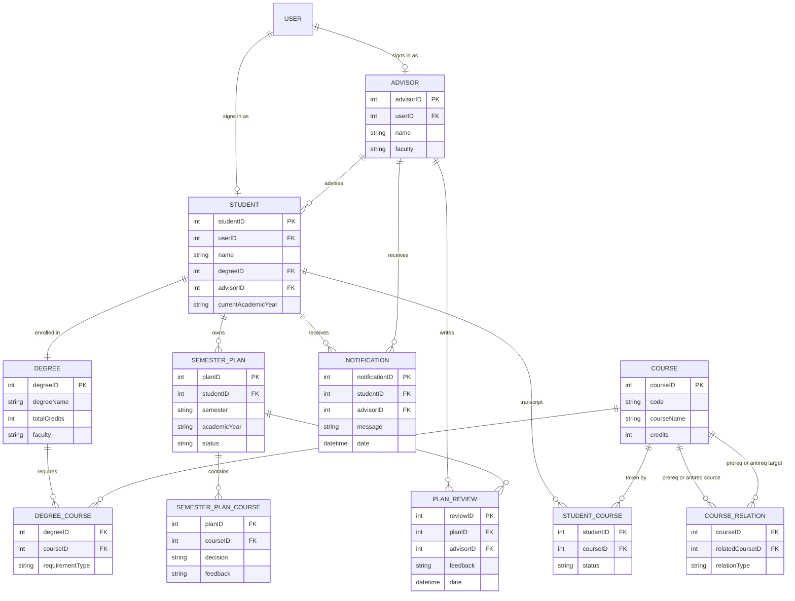
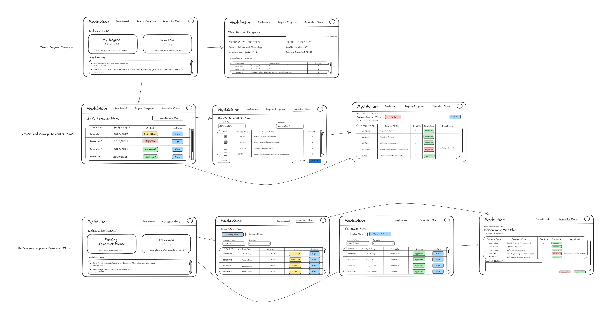

# COMP 3613 Assignment 1

Draft this file with the Guide. **Update it after every phase milestone** before you pause. The use-case diagram is a UML PNG at `docs/diagrams/use-case.png`, linked from this file as `diagrams/use-case.png` (path relative to `docs/report.md`). The model diagram is Mermaid. **Embed wireframe images** as `wireframes/<file>` (files live in `docs/wireframes/`).

Do not put your student ID in this file if you will commit it. The PDF cover adds your name and ID at export time.

## Assigned project

MyAdvisor — an app for students to track degree progress, plan semester course selections, and obtain approval from an administrator / advisor.

## Three workflows

### 1. Track Degree Progress (Student)

### 2. Create Semester Plan (Student)

### 3. View Semester Plan / Make Decision (Advisor)

## Use case diagram

Assumptions: authentication is out of scope (actors are pre-authenticated); Advisor's base use case is View Semester Plan, which «include» Make Decision; Make Decision in turn «include» Notify Student — so opening a plan always ends in a decision being recorded and the student notified, as a nested step of the decision; View Current Degree Progress dropped — student progress is covered by Track Degree Progress, which is not included by Create Semester Plan; no use cases are shared across actors.

## Model diagram

Revised in Phase 4 from the wireframe (`COURSE.code`, `SEMESTER_PLAN_COURSE.feedback`, `NOTIFICATION`, `STUDENT.currentAcademicYear` — see *Model revisions accepted in Phase 4*). Update again in Phase 5 when polish changes behaviour.

### Relationships and rules decided in Phase 3

- **Degree ↔ Course** — many-to-many through `DEGREE_COURSE`. `Degree.courseID` from the first list was dropped; a degree needs many required courses. `totalCredits` is checked against the sum of `credits` from `STUDENT_COURSE` rows that count toward the degree.
- **Course ↔ Course** — one self-referencing bridge `COURSE_RELATION` with `relationType` (`prereq` / `antireq`), replacing the comma-separated `prerequisiteCourses` / `antirequisiteCourses` columns.
- **Business rule** — a course whose prerequisite is not `Completed` in the student's transcript cannot be added to a semester plan; the app rejects the add and shows a message.
- **SemesterPlan is a header**, not a course line. `courseID` was moved off it. Courses live in `SEMESTER_PLAN_COURSE`. One plan per student per semester per academic year; each course on a plan is edited individually.
- **Three separate statuses** — `SEMESTER_PLAN.status` (`draft` / `submitted` / `approved` / `rejected`) is the plan lifecycle; `SEMESTER_PLAN_COURSE.decision` (`pending` / `approved` / `rejected`) is the advisor's per-course call; `STUDENT_COURSE.status` (`in_progress` / `completed` / `failed`) is transcript state.
- **Approve Decision** writes both: a per-course `decision` on each course and a plan-level `status`, plus a `PLAN_REVIEW` row carrying the feedback. (Refined in Phase 4 — the plan buttons finalise chips that are already set rather than deciding each course.)
- **PlanReview is history** — many reviews per plan across reject → edit → resubmit cycles, ordered by `date`. The current state is read from `Semester_PLAN.status`, never from the latest review.
- **Advisor ↔ Student** — each student has one assigned advisor (`Student.advisorID`); an advisor sees only their own students' submitted plans and has no route to students they do not advise.

### Assumptions carried into Phase 4

- One advisor per student. A student with no advisor assigned yet is allowed (nullable `advisorID`) but has no plan approval path until one is set.
- `requirementType` on `DEGREE_COURSE` (e.g. `core` / `elective`) is recorded but not yet used by a workflow; revisit if a wireframe filters by it.
- Deleting a student or a course is not in any named workflow — no cascade or soft-delete rule is modelled yet. Raise it if a wireframe implies it.

### Model revisions accepted in Phase 4

Driven by the wireframe, not invented:

- **`COURSE.code`** — every course row on *View Degree Progress*, *Create Semester Plan*, *Semester 2 Plan* and *Review Semester Plan* is labelled by code (COMP6031, INF08208). `courseName` alone could not carry both.
- **`SEMESTER_PLAN_COURSE.feedback`** — per-course feedback is a column on the student's plan detail ("Prerequisite not completed" against COMP6026) and on the advisor's review rows. `PLAN_REVIEW.feedback` stays as the single plan-level comment from the optional Feedback box.
- **`NOTIFICATION`** (`message`, `date`, recipient) — the Notifications lists on both dashboards. `Notify Student` was already a `«include»` of Make Decision but had nothing storing it; `ADVISOR` gets the same list for "Jasmin Singh submitted their Semester Plan".
- **`STUDENT.currentAcademicYear`** — shown on *View Degree Progress* and the source of the term filters on the plan screens.
- **Declined:** `DEGREE.totalCourses` was not added. The "Courses Completed: x/y" denominator is derived by counting `DEGREE_COURSE` rows.

### Business rules settled in Phase 4

- **Resubmit clears stale decisions.** *Edit Plan* reopens the same course grid; submitting returns the plan to `Submitted` and resets every `SEMESTER_PLAN_COURSE.decision` on it back to `pending`, so the advisor never sees a mix of old and new calls. The plan lands in the advisor's **Pending Plans** tab, not Reviewed.
- **A plan cannot be `approved` with a rejected course inside it.** Any rejected course forces the plan-level status to `rejected`; `approved` requires zero rejections.
- **Approve Plan / Reject Plan are a commit, not a decision.** They finalise the per-course chips the advisor already set on the rows and append one `PLAN_REVIEW` row carrying the optional feedback box. `Approve Plan` is refused while any row is still `pending` (assumed — the wireframe shows no error state for that case).
- **Prerequisite rejection is a service message.** The checkbox grid has no visible guard, so a student may tick a course with an unmet prerequisite; the add/submit is rejected with a message rather than blocking the control.

## Wireframes

### Full workflow set — MyAdvisor

One hand-drawn image covers all five use cases. Flows, left to right:

| Flow | Screens on the image |
|---|---|
| Track Degree Progress (Student) | Dashboard (*Welcome Bob*, My Degree Progress, Semester Plans, Notifications) → **View Degree Progress** (Degree, Faculty, Academic Year, 35% complete, Credits Completed / Remaining, Courses Completed, Completed Courses table) |
| Create Semester Plan (Student) | **Bob's Semester Plans** (Semester, Academic Year, Status, Actions, + Create New Plan) → **Create Semester Plan** (Academic Year + Semester pickers, Select / Course Code / Course Title / Credits checkboxes, Cancel / Save Draft / Submit) → **Semester 2 Plan** detail (status badge, Edit Plan, Decision + Feedback columns) |
| View Semester Plan (Advisor) | **Welcome Dr. Hosain!** (Pending Semester Plans, Reviewed Plans, Notifications) → **Semester Plan** list (Pending / Reviewed tabs, Academic Year + Semester filters, Student ID / Name / Semester / Status / Actions) |
| Make Decision (Advisor) | **Review Semester Plan** (Student ID, per-course Decision chips, per-course Feedback, Feedback (Optional) box, Reject Plan / Approve Plan) |
| Notify Student | Notifications list on the student dashboard ("Your semester plan has been approval", "One of the courses in your semester plan has been rejected…") |

<!-- student-build:wireframe-coverage
use_case: Track Degree Progress
image: docs/wireframes/MyAdvisor.png
covered: yes
-->
<!-- student-build:wireframe-coverage
use_case: Create Semester Plan
image: docs/wireframes/MyAdvisor.png
covered: yes
-->
<!-- student-build:wireframe-coverage
use_case: View Semester Plan
image: docs/wireframes/MyAdvisor.png
covered: yes
-->
<!-- student-build:wireframe-coverage
use_case: Make Decision
image: docs/wireframes/MyAdvisor.png
covered: yes
-->
<!-- student-build:wireframe-coverage
use_case: Notify Student
image: docs/wireframes/MyAdvisor.png
covered: yes
-->

## Theming

Branding preferences, and how they were applied to the landing, login, and register pages.

| Preference | Decision | Applied as |
|---|---|---|
| Colours | Navy blue, white, lilac, off white | `--brand-navy #1b2a4a`, `--brand-surface #ffffff`, `--brand-lilac #a58ce0`, `--brand-bg #f7f6fb` in `app/static/css/app.css` |
| Status colours | green = approved, red = rejected, yellow = submitted, light blue = draft | `--status-approved/rejected/submitted/draft` token pairs plus `.status-badge` classes used by the plan and review tables |
| Type | Modern sans serif, headings slightly larger; Nunito | DM Sans for body, Nunito for headings and the wordmark; `h1`–`h6` set only a step above body size (1.95rem → 0.95rem) |
| Tone | Straightforward and professional | Landing, auth, and shell copy is plain and factual — no marketing language |
| Wordmark | "MyAdvisor", "My" navy and "Advisor" lilac | `.brand-wordmark` split into `.wm-my` (navy) and `.wm-advisor` (lilac), used on the landing, auth panels, and the app header |

### Theme applied

- **Tokens** — `app/static/css/app.css` `:root` rewritten with the palette, the status colours, and the two font stacks; `base.html` now loads Nunito + DM Sans.
- **Landing `/`** — off-white page, navy type, lilac accents, wordmark headline, rewritten copy for degree progress / semester plans / advisor approval.
- **`/login` and `/register`** — white panel on an off-white and lilac ground, navy primary button, lilac focus ring, wordmark above the form heading.
- **Authenticated shell** — top bar (not the starter dark sidebar) with the wordmark, nav links, and the user chip, matching the wireframe's nav row.
- **`/401`** — restyled off the old blue gradient.
- **Starter demo removed** — the `/api/users` demo listing (`app/routers/users.py`) is deleted and unregistered. `/config`, login, register, and logout are kept.

## Implementation notes

One named workflow at a time. Include verify notes and polish / model revisions (Phase 5). Do not treat the first build as final.

### Model revision — Phase 5, workflow 1

The Phase 3 ERD had `STUDENT` and `ADVISOR` with their own IDs, but no link to the starter login `User`, so a signed-in account had nothing to read degree progress from. **Decision:** both profile tables carry a `userID` foreign key to `user`. Sign-in stays a separate concern from degree data, and `STUDENT` keeps only what is about the student.

| Change | Why |
|---|---|
| `STUDENT.userID` FK → `user` | Ties a login account to the student profile that owns the degree progress |
| `ADVISOR.userID` FK → `user` | Same, so the advisor's login account reaches the plans they advise |
| `DEGREE_COURSE` keeps its composite key `(degreeID, courseID)` | Matches the ERD bridge; the requirement type sits on the pair |
| `STUDENT_COURSE` uses the same composite key | A student takes a course once, so the pair identifies the transcript row |

### Workflow 1 — Track Degree Progress (Student)

Built to the wireframe: Dashboard → View Degree Progress.

| Layer | File | What it holds |
|---|---|---|
| Model | `app/models/progress.py` | `Degree`, `Course`, `Advisor`, `Student`, `DegreeCourse`, `StudentCourse` |
| Repository | `app/repositories/progress.py` | Degree lookup, required-course count, completed transcript joined to its course; writes used by the seeder |
| Service | `app/services/progress.py` | The arithmetic the screen shows — credits completed, remaining, percentage, courses completed of required |
| Route | `app/routers/progress.py` | `GET /app/progress` — thin, builds repository + service and renders `progress.html` |
| Templates | `app.html`, `progress.html` | Dashboard cards and the progress screen from the wireframe |
| Demo data | `app/cli.py` `_seed_myadvisor` | One degree, 31 required courses, Bob's profile and transcript (18 completed courses, 59 credits), Dr. Hosain as advisor |

**Student-authored snippets for this workflow** — see the `student-build:code-check` blocks below.

<!-- student-build:code-check
workflow: Track Degree Progress
form: choice
layer: model
architecture_ok: yes
implement_confidence: 0.78
passed: yes
note: Picked userID FKs on Student and Advisor, over reusing the login row as the profile or adding a second sign-in path.
-->

### Verify notes

**Theming + workflow 1, first pass (student run, `python manage.py run`):**

- Homepage loads; the MyAdvisor wordmark and navy / lilac / off-white palette read correctly.
- Signing in as `bob` works; registering a new account works.
- Student dashboard renders, but **the two panels were too small** — the wireframe draws them as large, prominent boxes with a heading, a one-line description, and an action.
- Note: the student had not yet opened **View Degree Progress** at this point.

**Polish applied in response:**

| Change | Reason |
|---|---|
| `.dashboard-tiles` grid — tiles now `min-height: 16rem`, `2rem` padding, left lilac rule | The panels read as the primary targets on the page, as drawn |
| `.tile-icon` lilac chip on each tile | Gives each box a visual anchor at the larger size |
| Tile heading raised to `1.6rem`; action button enlarged | Matches the wireframe's weight hierarchy |
| `.notifications-panel` given its own surface, title bar, and bulleted list | The wireframe shows a full-width Notifications box with bullet items, not a bordered card |

**Third polish pass (student, UI):**

| Request | Change |
|---|---|
| Centre everything on the dashboard | `.dashboard-greeting` centred; notifications panel body and list centred |
| Tile hover colour | Top rule and icon chip shift to the darker purple `--brand-accent-2` on hover instead of navy |
| Nav tabs | `ms-auto` on the nav list so the tabs sit immediately left of the user chip |
| Progress page header | `My Degree Progress` title added directly under the *Back to Dashboard* action |
| Full-width progress bar | `.progress-meter` is now its own full-width row above both columns |
| Facts under the bar, left | Degree, Faculty, Academic Year stacked one under the next |
| Figures under the bar, right | Credits Completed, Credits Remaining, Courses Completed stacked one under the next |
| Responsive | Breakpoints at 991.98px and 767.98px collapse the tile grid, the two progress columns, the progress meter, and the table padding to a single column; content padding shrinks on small screens |

**Fourth polish pass (student, reported defects):**

| Defect reported | Fix |
|---|---|
| Progress bar invisible on phone and tablet widths | The 768px rule switched `.progress-meter` to a column, which made `flex: 1` resolve on the vertical axis and collapse the bar's height to 0. The bar now opts out of flex sizing on small widths (`flex: 0 0 auto; width: 100%`) |
| "Sign out" text button | Replaced with the Material `logout` icon button carrying `title` / `aria-label`; the username also hides below the `sm` breakpoint to keep the chip compact |
| No vertical rules in tables | Column dividers added across app tables, with the outer left edge suppressed and a heavier header underline |

**Fifth polish pass (student):**

| Request | Change |
|---|---|
| Evenly spaced navbar tabs | `#app-nav` is now a centred flex row; the tab list is a row with a uniform `0.35rem` gap, links given equal vertical padding and `white-space: nowrap` so labels never wrap out of alignment; the user chip no longer shrinks |
| Wordmark | Weight raised to 800, tracking tightened to `-0.035em`, and "Advisor" now carries a lilac-to-deeper-purple gradient rather than flat lilac, with a solid-colour fallback for reduced-transparency users |

**Sixth polish pass (student):**

| Request | Change |
|---|---|
| Mobile navbar not responsive | The collapse/hamburger pattern is gone. `#app-header` is a three-column grid — wordmark, tabs, user chip. Below 992px it becomes two columns: wordmark and chip share row one, and the tabs take a full-width centred row of their own, so nothing is hidden behind a toggle |
| Tabs equally spaced across the navbar | Tabs are centred in the grid's middle column on wide screens and `space-evenly` across the full width below 992px — never left- or right-aligned |
| Welcome / Notifications left aligned | `.dashboard-greeting` and the notifications panel (title, list, and empty state) reverted to left alignment. The dashboard tiles stay centred |
| Larger wordmark | Header wordmark `1.4rem` → `1.9rem`, auth panel `1.6rem` → `1.95rem`, landing nav clamp raised |
| "r" in the wordmark clipped | The gradient clip box ended flush with the last glyph, shaving it at large sizes. `wm-advisor` now carries `0.14em` right padding with an equal negative margin, so the box extends past the glyph without moving the layout |
| Semester Plans tab missing | Expected — the tab is delivered with workflow 2 (Create Semester Plan), which owns the `/app/plans` routes. A tab wired to a route that does not exist yet would 404 |

**Workflow 2 polish pass (student, Create Semester Plan screen):**

| Request | Change |
|---|---|
| More space between the two dropdowns | Row gutter widened from `g-3` to `g-lg-5`, so Academic Year and Semester separate on large screens while staying close on phones |
| Cancel left, Save Draft and Submit right | Action row switched to `justify-content-between` — Cancel anchors left, the two submit buttons sit right, with extra top margin so they clear the course table |
| Remove green row background | Dropped the `table-success` class from completed course rows; the `Completed` badge beside the course title remains as the only marker |

### Verify notes

**Sixth polish pass (student):** buttons were rendering Bootstrap's stock bright `#0d6efd` blue everywhere except the auth panel and dashboard tiles, because the navy override was applied per-component. Added a global `.btn-primary` / `.btn-outline-primary` rule driven by a muted navy-blue token `--brand-primary #33528c` (hover `#2a4580`), and repointed the component-level overrides at it. Wordmark "My" and headings keep the original navy.

**Table alignment fixes (student):** Semester Plans Actions header left-aligned with the View button centred in its column; Credits header and values centred in the Create / Edit Semester Plan grid.

### Workflow 3 — View Semester Plan / Make Decision (Advisor)

**Decision taken before building:** the review screen is **one form**. Tapping Approve Plan or Reject Plan submits the decision chips, the per-course feedback boxes, and the optional plan-level feedback together; the service writes all of it and sets the plan status. The alternative — saving each chip as it is toggled — would have needed a save endpoint per change plus a separate commit.

**Model revision (Phase 5, workflow 3):** `STUDENT.studentNumber` added. The wireframe shows a real student ID (349836161) on the advisor's list and on the review screen header, which the surrogate key cannot carry.

| Layer | File | What it holds |
|---|---|---|
| Model | `app/models/review.py` | `PlanReview` (one advisor decision per plan — the history), `Notification` (addressed to a student or an advisor) |
| Repository | `app/repositories/review.py` | Advisor's own students' plans by status, plan-course rows, notifications, decision and status writes |
| Service | `app/services/review.py` | Approve refused while any course is pending or rejected; outcome, review row, and notification written in one commit |
| Route | `app/routers/review.py` | `/admin/plans` list with Pending/Reviewed tabs and filters, `/admin/plans/{id}` review screen, POST to commit |
| Templates | `admin.html`, `admin_plans.html`, `review_plan.html` | Advisor dashboard, plan list, and review screen from the wireframe |

**Phase 4 rules enforced in the service, not the route:** an advisor only reaches plans belonging to their own advisees (`Student.advisorID`); Approve Plan is refused while any row is pending, and refused outright if any row is rejected; the plan status, the `PLAN_REVIEW` history row, and the student notification are written in the same commit.

**Student-authored snippets for workflow 3:**

<!-- student-build:code-check
workflow: View Semester Plan / Make Decision
form: snippet
layer: model
architecture_ok: yes
implement_confidence: 0.82
passed: yes
note: PlanReview gains id, decision, feedback, and date, so a plan keeps one history row per review cycle.
-->

Two defects fixed on review: `Notification` had no primary key, and the service wrote `outcome=` against the student's `decision` column name.

<!-- student-build:code-check
workflow: View Semester Plan / Make Decision
form: snippet
layer: router
architecture_ok: yes
implement_confidence: 0.82
passed: yes
note: Flattens the courseID:decision values and parallel feedback list into a per-course mapping, validates it, and delegates to submit_review. No select/db.exec in the handler.
-->

**Two defects found while testing, both mine:**

| Symptom | Cause | Fix |
|---|---|---|
| Decision chips invisible | The CSS assumed the radio sat next to the ``, but the markup wraps it in a `<label>`, so `input + span` matched nothing | Selectors step through the label; hover, focus-visible, and disabled states added |
| Choosing one course cleared every other course | Every radio in the table shared `name="decision"`, making the whole table one radio group | Each row is now `decision_{{ courseID }}`, its own group |

**Routing redesign that followed from the second bug.** With one group per course the fields no longer share fixed names, so the handler reads `await request.form()` and scans for keys beginning with `decision_`, pairing each with `courseFeedback_{{ courseID }}`. The parallel-list `zip` and its "Invalid review submission" length check are gone — nothing can drift out of step now, and a course left undecided reaches the service's real rule instead of tripping a shape check. This also unblocks **Reject Plan with a partial set of decisions**, which Phase 4 permits and the length check had been blocking.

**Two further defects found on re-test:**

| Symptom | Cause | Fix |
|---|---|---|
| Approve Plan accepted a plan with a course still undecided | The rule scanned `decisions` — the courses the *form mentioned*. An unticked chip submits no field, so a pending course was invisible to the check | `submit_review` now resolves pending and rejected against the courses actually on the plan, defaulting anything the form omitted to `pending` |
| Bob's dashboard never showed notifications | `user_home_view` passed a hardcoded `"notifications": []` | Added `ReviewService.list_student_notifications` and wired it through; the advisor dashboard now goes through the matching `list_advisor_notifications` |

**Root cause behind items 4 and 5 — a vocabulary mismatch.** The review screen's buttons submit `value="approve"` and `value="reject"`, but `submit_review` compared `action` against `APPROVED = "approved"` and `REJECTED = "rejected"`. `if action == APPROVED` was therefore never true, so **both Phase 4 approval rules were unreachable dead code** — every Approve click fell straight through to committing the plan. Reject happened to work only because the fallback expression happened to line up.

Rather than rely on one spelling matching, the action is now normalised through a lookup that accepts the imperative and past-tense forms of both, and an unrecognised action is refused instead of silently treated as an approve. Verified against the service directly:

| Case | Result |
|---|---|
| Approve with one course untouched | refused — "Set a decision on every course before approving this plan." — status stays `submitted` |
| Approve with one course rejected | refused — "This plan cannot be approved while a course on it is rejected." — status stays `submitted` |
| Reject with one course untouched | accepted — status becomes `rejected` |

**Final polish (workflow 3, found while reading back the plan screens):** the plan detail screen offered **Edit Plan** on any plan that was not `approved`, which included plans sitting in `submitted` — the advisor was mid-review and the student could still rewrite it. The service refused that save anyway, so the button was a dead end. `canEdit` now matches the service's own rule: draft or rejected only.

### Phase 5 exit

**Responsive pass (student, across every screen).** The widest tables were the real risk — a five-column review table crushed into unreadable slivers on a phone:

| Change | Why |
|---|---|
| `.course-table-wrap` scrolls on both axes, tables keep a `38rem` floor | Columns stay legible; the card scrolls sideways instead of squeezing them |
| `.table-wide` raises the floor to `56rem` on the review and plan-detail tables | Those carry decision chips and feedback boxes that genuinely cannot compress |
| Decision chips wrap below 768px | Two chips plus a feedback box no longer force the row wider than the screen |
| Long course titles allowed to wrap | A long title no longer stretches its row and forces the whole table sideways |
| Tile grid `minmax(min(20rem, 100%), 1fr)` | The grid can no longer overflow a viewport narrower than 20rem |
| Landing nav and CTAs stack full-width below 576px | The header no longer forces horizontal page scroll |
| `text-size-adjust: 100%`, `max-width` on media and tables | Stops iOS inflating text in landscape and stops any table exceeding its container |

All three named workflows are built and working locally, and the student has steered eight rounds of polish across them — layout and spacing on the dashboard and progress screens, the mobile navbar, the wordmark, table alignment, button colour, the Create Semester Plan action row, this responsive pass, and the several behavioural bugs above. Model revisions were made in Phase 5: the `userID` foreign keys, `STUDENT_COURSE`'s composite key, the seeded prerequisites, and `STUDENT.studentNumber`.

Note on attribution: the workflow 3 review route was written by the student, then **rewritten by the Guide** at their request after the form's field naming changed, so the per-course mapping in its current form is Guide work on a student-authored structure. It remains thin — no SQL in the handler.

**Model / demo-data revision (Phase 5, workflow 2):** every seeded prerequisite originally pointed at a course Bob had already completed, so the prerequisite rejection could never fire and his rejected plan's "Prerequisite not completed" feedback was untrue. Re-pointed `INF08206` at `INF08201` (Discrete Mathematics, which Bob **failed**), which makes that seeded rejection truthful. `INF08207` and `COMP6047` now chain behind `INF08206`, and `COMP6045` behind `COMP6037`, giving four courses the demo can actually block.

### Workflow 2 — Create Semester Plan (Student)

**Verify note (student):** items 1–4 confirmed against the running app — Save Draft lands a Draft badge, Submit lands Submitted with every course Pending, a second plan for the same term is refused, and a blocked prerequisite is refused with the missing course named.

**Workflow 2 bugs found and fixed:**

| Defect | Cause | Fix |
|---|---|---|
| Save Draft / Submit disabled while editing a rejected plan | `form.submitting` was derived from `detail.status == "rejected"` and bound to both buttons | Buttons no longer gate on that flag |
| Edited course selection silently discarded | The edit form posted to `plan_resubmit_action`, which only re-marked the plan and never saved the ticked courses | Form now posts to `plan_create_action` with a hidden `planID`; added `PlanningService.update_plan`, which rebuilds the course rows (resetting decisions to pending and clearing feedback) and sets the new status |
| Edit still hit "You already have a plan for Semester 2" | `plan_create_action` only called `create_plan`, which enforces one-plan-per-term | Route now branches on `planID` to call `update_plan`; the create path is unchanged |

**Route completed by the student (workflow 2):** `plan_create_action` now branches on `planID` to call `update_plan`, validates that `action` is `draft` or `submit`, and redirects back to the edit form rather than the create form when a save is refused. The one-plan-per-term refusal no longer fires on an edit.

**Decision taken before building:** the Create Semester Plan picker offers **the whole course catalogue**, not just the student's degree requirements. The wireframe's grid is not filtered by degree, and this keeps a repeated course plannable. Consequence: a ticked course that is already on the transcript is allowed at selection time and warned about, rather than being silently hidden.

Built to the wireframe: Bob's Semester Plans list → Create Semester Plan grid → Semester Plan detail → Edit Plan.

| Layer | File | What it holds |
|---|---|---|
| Model | `app/models/planning.py` | `SemesterPlan` (header: semester, academic year, lifecycle status), `SemesterPlanCourse` (a course on a plan, its advisor decision and per-course feedback), `CourseRelation` (the prereq/antireq bridge) |
| Repository | `app/repositories/planning.py` | Plan lookup by student and term, the full course catalogue, plan-course rows, prereq lookups |
| Service | `app/services/planning.py` | One plan per student per term; prerequisite rejection; submit clears stale decisions |
| Route | `app/routers/planning.py` | `/app/plans` list, `/app/plans/new`, `/app/plans/{id}`, `/app/plans/{id}/edit` |
| Templates | `plans.html`, `plan_form.html`, `plan_detail.html` | List, checkbox grid, and detail screens from the wireframe |

**Student-authored snippets for workflow 2:**

<!-- student-build:code-check
workflow: Create Semester Plan
form: snippet
layer: model
architecture_ok: yes
implement_confidence: 0.84
passed: yes
note: studentID FK plus UniqueConstraint on (studentID, semester, academicYear) puts the one-plan-per-term rule in the database, not just the service.
-->

Three defects found on review and corrected by the student: the Submit branch had no `return` so the handler fell through to `None`; `create_plan` was called with a fifth argument it does not accept, which would have raised `TypeError` on every save; and the submit error path passed `plan_id` to a route that takes no such parameter.

<!-- student-build:code-check
workflow: Create Semester Plan
form: snippet
layer: router
architecture_ok: yes
implement_confidence: 0.84
passed: yes
note: Builds both repositories and the service, delegates every rule to it, no select/db.exec in the handler.
-->

**Model + route snippets completed by the student:**

<!-- student-build:code-check
workflow: Track Degree Progress
form: snippet
layer: model
architecture_ok: yes
implement_confidence: 0.85
passed: yes
note: degreeID required + advisorID optional on Student; studentID/courseID as the composite key on StudentCourse.
-->
<!-- student-build:code-check
workflow: Track Degree Progress
form: snippet
layer: router
architecture_ok: yes
implement_confidence: 0.85
passed: yes
note: Builds ProgressRepository + ProgressService and calls the service with the signed-in user id; no select/db.exec in the handler.
-->

## Deployed app

Phase 6. Public Render URL (not localhost). Markers open this to mark the three workflows.

https://

## Logins

Every account a marker needs, including extra users you added. Starter accounts:

- bob / bobpass — regular user
- admin / adminpass — admin

## YouTube URL

## Session transcripts

Filled when the Guide builds the report: the agent writes each Guide chat to `docs/transcripts/<slug>.md` (Copilot Agent, Cursor, or OpenCode). `python manage.py report` packages them. Do not paste chats here during the build.

## Competency (student-judge)

Filled when the report is built. Guide runs student-judge, writes `docs/judge.md`, and export appends the scorecard here.

## Skill integrity

Filled by `python manage.py report`. Do not edit the course skills.
